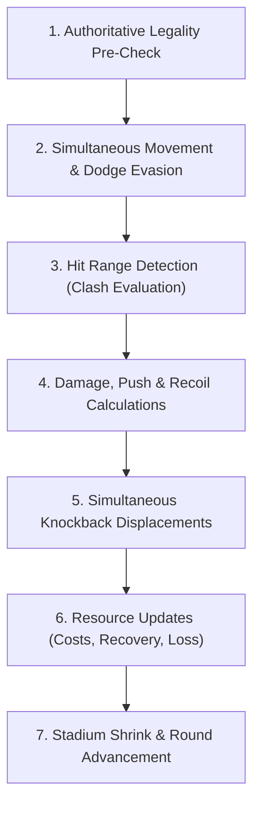

# BLADE ARENA — Combat and Simultaneous Round Resolution

> **Status Notice:** This document specifies **Module 7: Combat and Simultaneous Round Resolution**. It establishes the complete, shared Classic Dish combat simulation engine (`ClassicDishRoundResolver`), which governs action execution, hit detection, damage scaling, knockback displacement, guard counter-recoils, self-recoils, passive energy drain, and dynamic stadium shrinking. Elimination evaluation, points scoring, and match victory assignment are **not implemented** in this module (deferred to Module 8).

---

## 1. Combat Rules Architecture

BLADE ARENA resolves combat turns using a single, deterministic, authoritative rules engine. The same simulation engine is shared across:
1. Interactive human player matches.
2. Direct AI vs. AI simulations.
3. Tree-search rollouts (Minimax depth lookaheads and MCTS simulations).

Both combatants select their actions secretly and simultaneously. Neither combatant is granted automatic execution priority.

---

## 2. Central Combat Configuration

All numeric combat parameters are encapsulated in the immutable `CombatConfig` dataclass (`blade_arena/game/combat.py`):

| Parameter | Value | Scope / Intent |
| :--- | :---: | :--- |
| `normal_attack_damage` | `12.0` | Base stability damage for a standard Attack. |
| `normal_attack_push` | `1.2` | Base knockback push distance for a standard Attack. |
| `normal_attack_hit_range` | `1.2` | Maximum post-movement distance for an Attack to land. |
| `special_spin_damage` | `25.0` | Base stability damage for a Special Spin strike. |
| `special_spin_push` | `2.0` | Base knockback push distance for a Special Spin strike. |
| `special_spin_hit_range` | `1.2` | Maximum post-movement distance for Special Spin to land. |
| `special_spin_self_recoil` | `10.0` | Self-stability recoil incurred on Special Spin (hit or miss). |
| `special_spin_cooldown_seconds` | `3.0s` | Ready timestamp offset (`elapsed_game_time + 3.0s`). |
| `charging_defender_damage_multiplier` | `1.25` | Damage multiplier against a charging combatant (+25%). |
| `charging_defender_push_multiplier` | `1.25` | Push multiplier against a charging combatant (+25%). |
| `guard_normal_damage_multiplier` | `0.50` | Damage multiplier when Normal Attack strikes Guard (-50%). |
| `guard_normal_push_multiplier` | `0.50` | Push multiplier when Normal Attack strikes Guard (-50%). |
| `guard_special_damage_multiplier` | `0.70` | Damage multiplier when Special Spin strikes Guard (-30%). |
| `guard_special_push_multiplier` | `0.70` | Push multiplier when Special Spin strikes Guard (-30%). |
| `guard_attacker_recoil_normal_attack` | `3.0` | Stability recoil inflicted on attacker when hitting Guard. |
| `hit_range_tolerance` | `1e-9` | Numerical tolerance for floating-point distance checks. |

*Note: In accordance with project instructions, these values are proposed starting calibrations and may be tuned.*

---

## 3. Order of Operations in a Combat Round

Every combat round progresses through seven deterministic stages:

### Stage 1: Authoritative Legality Pre-Check
Both actions are validated against the pre-round `MatchState` using Module 5 legality rules:
- Current energy must be greater than or equal to action cost.
- Special Spin requires `elapsed_game_time >= special_ready_at`.
- If either action is illegal, the resolver raises `IllegalRoundResolutionError`. The pre-round state and pending commitments remain untouched.

### Stage 2: Simultaneous Movement & Dodge Evasion
Both combatants execute their planned movements simultaneously from the common pre-round positions (Module 6):
- `Guard`: Stays in place (`0.0` displacement).
- `Charge`: Moves up to `1.0` unit toward arena center `(0.0, 0.0)` (capped at center).
- `Attack`: Moves up to `1.6` units toward opponent's pre-round position (capped at target).
- `Special Spin`: Moves up to `2.0` units toward opponent's pre-round position (capped at target).
- `Dodge`: Moves `1.4` units orthogonally toward arena interior. If the final margin is at least `0.5` units, `dodge_success` is flagged as `True`; otherwise `False`.

### Stage 3: Hit Range Detection
Hit evaluation occurs using post-movement positions *before* knockback pushes are applied:
$$\text{dist\_post} = \text{distance}(P_{1,\text{post}}, P_{2,\text{post}})$$
An attack lands if:
1. The action is `ATTACK` or `SPECIAL_SPIN`.
2. $\text{dist\_post} \le \text{hit\_range} + \epsilon$.
3. The defender did **not** execute a successful Dodge (`not (defender_action == DODGE and dodge_success)`).

> [!IMPORTANT]
> Both attacks are evaluated against the same intermediate post-movement distance. If both players attack and reach within `1.2` units of each other, **both attacks hit simultaneously**.

### Stage 4: Damage, Push, and Recoil Calculations
For every landed attack from attacker $A$ to defender $B$:
- **Outgoing Stability Damage:**
  $$\text{damage} = \text{base\_damage} \times \text{power\_multiplier}_A \times \text{stance\_damage\_multiplier}_B$$
  *(Scaled by attacker's archetype attack power multiplier).*
- **Knockback Push Magnitude:**
  $$\text{push\_magnitude} = \text{base\_push} \times \text{stance\_push\_multiplier}_B$$
  *(Attack power multiplier does NOT scale push magnitude).*
- **Attacker Recoil:**
  - If Normal Attack hits a Guarding defender: attacker suffers `3.0` stability recoil.
  - Special Spin does not incur Guard counter-recoil.
- **Special Spin Self-Recoil:**
  - Any blade executing Special Spin incurs `10.0` stability self-recoil, whether the attack hits or misses.

### Stage 5: Simultaneous Knockback Displacements
Push vectors are calculated from attacker post-movement position toward defender post-movement position:
$$\hat{u} = \frac{P_{B,\text{post}} - P_{A,\text{post}}}{\|P_{B,\text{post}} - P_{A,\text{post}}\|}$$
$$\vec{w}_B = \text{push\_magnitude}_B \times \hat{u}$$
- **Coincidence Handling:** If combatants coincide post-movement, the direction defaults to pre-movement relative orientation. If pre-movement positions also coincided, documented fallbacks (`(1.0, 0.0)` for P1 attacking P2, `(-1.0, 0.0)` for P2 attacking P1) are applied.
- Knockback displacements are added simultaneously: $P_{\text{final}} = P_{\text{post}} + \vec{w}$.

### Stage 6: Resource Updates & Clamping
Resources update in strict order:
1. **Subtract Cost:** $E_1 = E_{\text{start}} - \text{energy\_cost}$.
2. **Apply Recovery:**
   - Charge: $E_2 = \min(E_{\text{max}}, E_1 + \text{charge\_recovery})$.
   - Guard: $S_1 = \min(S_{\text{max}}, S_{\text{start}} + \text{guard\_recovery})$.
3. **Subtract Combat Losses:**
   - Stability loss: $S_2 = S_1 - \text{damage\_received} - \text{self\_recoil} - \text{guard\_recoil}$.
   - Passive loss: $E_3 = E_2 - \text{passive\_energy\_loss}$.
4. **Clamp at Zero:**
   - $E_{\text{final}} = \max(0.0, E_3)$.
   - $S_{\text{final}} = \max(0.0, S_2)$.
5. **Special Spin Cooldown:**
   - If Special Spin was chosen, `special_ready_at = elapsed_game_time + 3.0s`.

### Stage 7: Stadium Shrink & Advancement
- If `(completed_rounds + 1) % 6 == 0`, arena radius decreases by `1.0` (clamped at `6.0`).
- Completed rounds increments by exactly `1`.
- Match status remains `IN_PROGRESS` (terminal evaluation deferred to Module 8).

---

## 4. Defender Stance Interaction Matrix

| Attacker Action | Defender Action | Hit Outcome | Defender Damage | Defender Push | Attacker Recoil | Special Spin Self-Recoil |
| :--- | :--- | :---: | :---: | :---: | :---: | :---: |
| **Attack** | **Charge** | Hit | $12.0 \times \text{Power} \times 1.25$ | $1.2 \times 1.25$ | 0.0 | 0.0 |
| **Attack** | **Guard** | Hit | $12.0 \times \text{Power} \times 0.50$ | $1.2 \times 0.50$ | **3.0** | 0.0 |
| **Attack** | **Dodge (Success)** | **Miss** | 0.0 | 0.0 | 0.0 | 0.0 |
| **Attack** | **Dodge (Failed)** | Hit | $12.0 \times \text{Power} \times 1.00$ | $1.2 \times 1.00$ | 0.0 | 0.0 |
| **Attack** | **Attack** | Both Hit | $12.0 \times \text{Power} \times 1.00$ | $1.2 \times 1.00$ | 0.0 | 0.0 |
| **Special Spin**| **Charge** | Hit | $25.0 \times \text{Power} \times 1.25$ | $2.0 \times 1.25$ | 0.0 | **10.0** |
| **Special Spin**| **Guard** | Hit | $25.0 \times \text{Power} \times 0.70$ | $2.0 \times 0.70$ | 0.0 | **10.0** |
| **Special Spin**| **Dodge (Success)** | **Miss** | 0.0 | 0.0 | 0.0 | **10.0** |
| **Special Spin**| **Special Spin** | Both Hit | $25.0 \times \text{Power} \times 1.00$ | $2.0 \times 1.00$ | 0.0 | **10.0** (both) |

---

## 5. Controller Integration & Atomic Reselection Workflow

When integrating `ClassicDishRoundResolver` with `MatchController`:
1. `MatchController` calls `resolver.resolve_round(state, p1_action, p2_action)`.
2. If an action is illegal, the resolver raises `IllegalRoundResolutionError`. The controller catches this and raises `RoundResolutionError` without altering pre-round state or pending commitments.
3. The controller exposes `clear_pending_action(player_id)`:
   - Allows a player to discard their invalid action and resubmit a legal one.
   - Preserves the other player's committed action secretly, preventing opponent action disclosure.

---

## 6. Scope Boundaries & What Remains Unimplemented

- **Victory Evaluation:** Ring-out, burst, spin-out, and 40-round points decisions are not evaluated in this module (Module 8).
- **Match Status:** Status remains `IN_PROGRESS` regardless of resource levels or arena perimeter containment.
- **AI Systems:** Minimax, MCTS, and Mamdani fuzzy inference are implemented in Modules 9–12.
